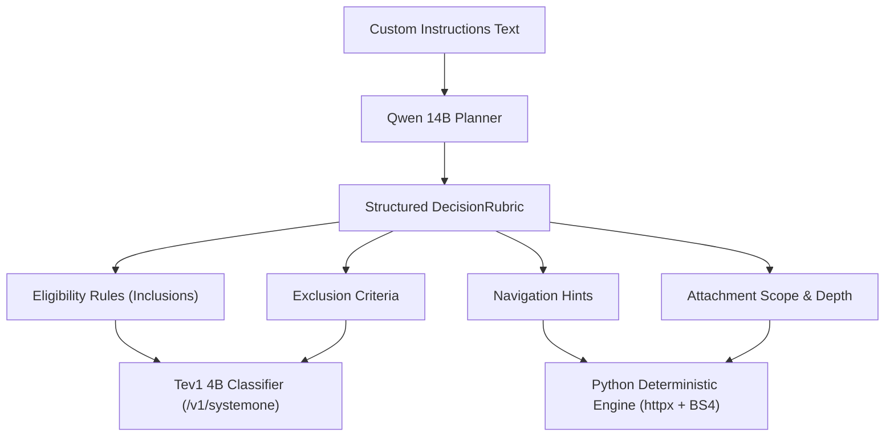

# SmartScraper Instruction Authoring Guide for LLMs

> **Audience**: AI Language Models (ChatGPT, Claude, Gemini, local LLMs) and prompt engineers generating project instructions for **SmartScraper**.
>
> **Goal**: Produce precise, high-yield instructions combining document selection criteria and website navigation hints that local models (`qwen3:14b` and `tev1:4b`) can reliably compile and execute.

---

## 1. How SmartScraper Consumes Instructions

SmartScraper does **not** hand the entire crawl or browser control to an LLM. Instead, it follows a deterministic architecture:



1. **Planner (`qwen3:14b`)**: Runs **once** at the start of a project run. It parses the instructions into a `DecisionRubric`:
   - `eligibility_rules`: List of positive criteria.
   - `exclusions`: List of negative criteria.
   - `navigation_hints`: Hints for structure, layout, and where attachments reside.
   - `attachment_scope`: Which types of files to download (e.g. comment letters, appendices).
2. **Classifier (`tev1:4b`)**: Runs on **each individual submission** using Ollama's `/v1/systemone` decision API. It selects between discrete choice labels:
   - Listing Stage: `select`, `reject`, `needs_detail`, `uncertain`
   - Detail Stage: `select`, `reject`, `uncertain`
3. **Python Orchestrator**: Handles all HTTP requests, pagination, rate limiting, DOM parsing, deduplication, and file downloading.

---

## 2. Fundamental Constraints & Principles

When authoring instructions, LLMs **MUST** adhere to the following constraints:

### 1. Plain Natural Language Only
- **DO NOT** write CSS selectors, XPath expressions, regular expressions, or Python code.
- Python handles DOM extraction and candidate discovery deterministically.
- Write human-readable descriptions of layout and controls (e.g., *"This is a paginated list. Open each title link to inspect the full comment."*).

### 2. Best-Effort Inference from Visible Text
- Selection happens **strictly from visible metadata on the web page** (table columns, headings, short summaries, detail descriptions, submitter names, and attachment filenames).
- **DO NOT** ask the model to:
  - Search external websites to verify an author's identity or employment.
  - Read attachment bodies, extract PDF text, or perform OCR before deciding. Selection must occur **before** downloading.
  - Hallucinate background facts not present in the visible text.

### 3. Separate Topic Relevance from Submitter Eligibility
If the project requires both a specific subject (e.g., *California SB 253*) and a specific organization type (e.g., *Environmental NGOs*):
- Define them as separate, explicit conditions.
- Specify how to treat personal names versus organizations (e.g., *"A personal name alone does not establish institutional affiliation"*).
- Specify how to treat joint submissions (e.g., *"Include joint SB 253/SB 261 submissions when SB 253 is explicitly covered"*).

### 4. Provide Explicit Exclusions
- Decision models perform best when unambiguous boundaries are established.
- Always include clear exclusion criteria (e.g., *"Exclude comments discussing only SB 261, personal individuals, or commercial sales solicitations"*).

### 5. Explicitly Direct Uncertain Cases to Review
- Instruct the model to route ambiguous cases to `uncertain` / `Review` rather than guessing.
- In SmartScraper, uncertain items are logged to a Review queue in the UI and **never block** the crawl from finishing.

### 6. Distinguish Listing vs. Detail Navigation
- If attachments or full descriptions are on submission detail pages, explicitly note this as a navigation hint:
  - *"Shortlist submissions on the listing page. If the listing description is brief, open the submission detail link to read the full statement and discover attachment links."*

---

## 3. Recommended 4-Part Instruction Template

When an LLM generates instructions for SmartScraper, it should output a single cohesive text block structured around these 4 sections:

```text
[1. TARGET OBJECTIVE & SCOPE]
Download comment/submission attachments concerning [SPECIFIC TOPIC/PROCEEDING].
Target document types: [e.g., substantive PDF and Word responses; exclude logos, guidelines, and slide decks].

[2. INCLUSION & ELIGIBILITY RULES]
Select submissions meeting BOTH/EITHER conditions:
- Topic Relevance: [Specific subjects, bills, questions, or initiatives]. Include joint submissions if [CONDITION].
- Submitter Eligibility: Submitted by [list of eligible stakeholder types: NGOs, trade associations, academic institutions, etc.].

[3. EXPLICIT EXCLUSIONS]
Exclude submissions that:
- Address only [UNRELATED TOPICS].
- Are submitted by individuals speaking in a purely personal capacity.
- Represent individual commercial vendors pitching products/services.
- Lack substantive comments or attachments.

[4. NAVIGATION & EVIDENCE GUIDELINES]
- Layout Hints: [e.g., "This is a paginated table" or "Items are presented as cards with a 'Read More' detail link"].
- Evidence: Use visible title, submitter/affiliation text, summary, and attachment filenames as evidence.
- Uncertainty: If evidence is insufficient to verify both conditions, classify as Review/Uncertain rather than guessing.
```

---

## 4. Production Examples

### Example 1: CARB Public Comments (Paginated Table)
```text
Download comment attachments concerning California SB 253 submitted by industry associations; institutional investors and financial coalitions; environmental NGOs; environmental justice and community coalitions; accounting, auditing and professional standards bodies; labor unions and labor coalitions; academic centers; think tanks; and policy clinics. Include joint SB 253/SB 261 submissions when SB 253 is explicitly covered. Exclude submissions concerning SB 261 alone, unrelated proceedings, individuals speaking solely in a personal capacity, and individual commercial companies unless they fall within one of the requested categories. Use subject, submitter information and attachment filenames as evidence. Put cases with insufficient evidence into Review rather than guessing.
```

### Example 2: European CSRD Public Consultation (List-to-Detail Flow)
```text
This is a paginated consultation list. Use the short card summary to shortlist submissions concerning the Corporate Sustainability Reporting Directive (CSRD) interoperability and assurance standards. Open each potentially relevant submission's title link. Read its longer description on the detail page and download the attached response document near the bottom. Only include responses submitted by auditing standard bodies, trade federations, environmental coalitions, or university policy institutes. Exclude submissions discussing general EU taxonomy without direct CSRD comments, individual citizens, and general portal guidance documents. Base selection on visible submission text and attachment titles. Place ambiguous affiliations into Review.
```

### Example 3: SEC Rulemaking Comment Letters
```text
Download public comment attachments regarding SEC Proposed Rule on Climate-Related Disclosures (File No. S7-10-22). Include submissions from publicly traded registrants, institutional asset managers, institutional proxy advisors, state attorneys general, and legal scholar coalitions. Exclude form letter templates from individual retail investors and submissions that solely address digital asset/crypto regulations. Use the comment row title, submitter organization, and PDF file names. If a row links to an individual submission landing page, follow the link to download the substantive comment letter while ignoring portal navigation files. Route cases with unclear institutional status to Review.
```

### Example 4: Municipal Zoning & Land Use Public Hearing
```text
This is a city planning portal with agenda items. Download staff reports and public objections regarding high-density mixed-use residential rezoning proposals. Exclude routine administrative variance requests, single-family residential permits, and commercial signage reviews. Open each agenda item link to discover downloadable exhibits and staff recommendations. Download primary staff reports and formal stakeholder opposition letters; ignore meeting minutes and audio recordings. Classify submissions lacking explicit parcel or project descriptions as Uncertain.
```

---

## 5. Common LLM Anti-Patterns to Avoid

| Anti-Pattern | Why It Fails in SmartScraper | Correct Approach |
|---|---|---|
| `"Use CSS selector table.comments > tr"` | SmartScraper's Python engine handles selectors and candidate discovery; raw selectors confuse the rubric planner. | Use natural language: *"This is a paginated table with Name, Subject, and File columns."* |
| `"Search Google or LinkedIn to verify if John Smith works for an NGO"` | SmartScraper is completely local and offline for inference; it cannot access third-party search engines. | *"Use only visible affiliations and email domain/organization text present on the page."* |
| `"Download the PDF, inspect page 3, and select if it mentions section 4.1"` | SmartScraper selects **before** downloading to avoid downloading gigabytes of irrelevant documents. | *"Select based on visible title, abstract, listing description, and attachment filename."* |
| `"If unsure, guess the most probable match"` | Guessing pollutes datasets with false positives and downloads irrelevant files. | *"If evidence is insufficient, mark as Review/Uncertain."* |
| `"Download all files including logos and icons"` | Wastes bandwidth and storage on site assets. | *"Download substantive response attachments; ignore site assets and navigation links."* |

---

## 6. Meta-Prompt for Generating SmartScraper Instructions

You can give the following system prompt to any LLM to ask it to author instructions for a target website:

```markdown
You are an expert prompt engineer for SmartScraper, a local AI document discovery tool.
Your job is to write a single, cohesive, plain-text instruction block for a user's target scraping task.

Follow these strict rules:
1. Output ONLY the instruction text (no preamble, no markdown headers, no code snippets).
2. Do NOT write CSS, XPath, or code. Use plain English descriptions of the layout and navigation.
3. Clearly define:
   - Target documents and topic criteria.
   - Eligible submitters/organizations vs personal capacity.
   - Explicit exclusion criteria.
   - Where files and descriptions are located (listing vs detail page).
   - Instruction to route insufficient evidence to Review/Uncertain.
4. Keep the text under 150 words so it fits comfortably within local model context windows.

User Request: [USER SPECIFIES TARGET SITE, PROCEEDING, AND GOAL HERE]
```
